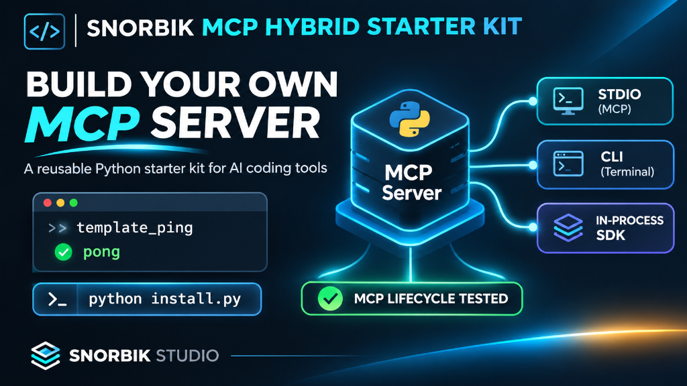

# snorbik-mcp-hybrid-starter-kit



[](#)
[](#)
[](#)
[](#)
[](#)
[](#)

> **Starter Kit Architecture MCP Hybride Tri-Canal**  
> Gabarit de démarrage Python combinant 3 modes d'accès pour vos outils IA :  
> **1. Canal STDIO** pour les clients MCP (Cursor, VS Code, Claude Code).  
> **2. Canal CLI** pour vos scripts terminal et pipelines CI/CD.  
> **3. Canal SDK In-Process** pour vos applications Python en mémoire sans surcoût IPC.

---

## 1. Carte d'Identité & Spécifications

| Propriété | Description |
| :--- | :--- |
| **Composant** | `snorbik-mcp-hybrid-starter-kit` |
| **Licence** | **MIT Open-Source** (usage commercial et personnel libre) |
| **Spécification MCP** | **JSON-RPC 2.0 (Spécification officielle 2025-11-25)** |
| **Environnement** | Python 3.10+ (Windows, macOS, Linux) |
| **Clients Supportés & Testés** | **Cursor**, **VS Code**, **Claude Desktop**, **Claude Code CLI** |
| **Patron de Conception** | Clean Architecture Tri-Canal (Core / Domain / Application / Adapters) |

---

## 2. Guide d'Installation Multi-Clients

### Option A : Install with your AI Coding Agent (Recommandée)

Si vous travaillez avec un agent de code (Cursor Agent, Claude Code, VS Code Copilot), copiez-collez simplement ce prompt dans votre chat IA :

```text
Tu es mon ingénieur d'intégration. Configure le serveur MCP depuis ce dépôt :
1. Identifie le client MCP réellement actif dans notre session (Cursor, VS Code, Claude Code ou Claude Desktop).
2. Lis les instructions du README et sélectionne l'argument approprié pour l'installation (--client cursor, --client vscode, --client claude ou --client all).
3. Lance `python install.py --client <client_choisi>` et vérifie le code retour d'exécution.
4. Si nécessaire, rappelle-moi de recharger la fenêtre de mon client (Developer: Reload Window).
5. Vérifie que le serveur répond correctement en appelant l'outil `template_ping` et valide la réception de la réponse `pong`.
6. Rapporte-moi clairement le résultat du test et signale toute erreur éventuelle sans la masquer.
```

---

### Option B : Installation Automatisée (Terminal)

Exécutez le script universel `install.py` à la racine du dépôt :

```bash
# Installation automatique tous clients détectés :
python install.py

# Ou installation ciblée selon votre environnement :
python install.py --client cursor   # Configure ~/.cursor/mcp.json (clé "mcpServers")
python install.py --client vscode   # Configure .vscode/mcp.json (clé officielle "servers")
python install.py --client claude   # Configure Claude Desktop et enregistre via claude mcp add
python install.py --client all      # Auto-détection et configuration universelle
```

#### Sécurité et Résilience de l'Installateur :
- **Vérification stricte de `pip install`** : toute anomalie de dépendances bloque l'installation avec code d'erreur explicite.
- **Protection anti-corruption JSON** : si un fichier de configuration existant est syntaxiquement invalide, l'installateur génère une sauvegarde `.corrupted.bak` et **refuse formellement d'écraser le fichier**.
- **Préservation intégrale** : tous vos serveurs MCP et configurations existantes sont conservés sans perte.

---

### Option C : Installation Manuelle Développeur

```bash
# 1. Cloner et installer en mode éditable
git clone https://github.com/snorbik-ai/snorbik-mcp-hybrid-starter-kit.git
cd snorbik-mcp-hybrid-starter-kit
pip install -e .

# 2. Exécuter la suite de tests unitaires
pytest
```

---

## 3. Configuration Manuelle des Clients

Si vous préférez déclarer manuellement ce serveur, voici les blocs de configuration prêts à copier :

#### Pour Cursor (`~/.cursor/mcp.json`) & Claude Desktop (`claude_desktop_config.json`) :
```json
{
  "mcpServers": {
    "snorbik-mcp-hybrid-starter-kit": {
      "command": "python",
      "args": ["template_mcp_hybride/canal_mcp/mcp_server.py"],
      "env": { "PYTHONIOENCODING": "utf-8" },
      "type": "stdio"
    }
  }
}
```

#### Pour VS Code (`.vscode/mcp.json` - Spécification Officielle VS Code) :
```json
{
  "servers": {
    "snorbik-mcp-hybrid-starter-kit": {
      "command": "python",
      "args": ["template_mcp_hybride/canal_mcp/mcp_server.py"],
      "env": { "PYTHONIOENCODING": "utf-8" }
    }
  }
}
```

---

## 4. Outils Déclarés (`tools`) & Test de Fonctionnement

Ce serveur expose deux outils déterministes validés selon le schéma Pydantic :

| Outil (`tool`) | Rôle & Usage | Paramètres | Réponse Attendue |
| :--- | :--- | :--- | :--- |
| `template_ping` | **Test de réactivité et santé du serveur.** À appeler immédiatement après l'installation pour vérifier la liaison. | `aucun` | DTO `ToolResponseDto` avec `status: "SUCCESS"` et `payload.reply: "pong"`. |
| `template_execute_action` | **Démonstration de validation et sérialisation.** Permet de transmettre une charge utile typée. | `message (str, requis)` | DTO enrichi avec horodatage Unix certifié et écho validé. |

#### Cycle de vie MCP vérifié :
1. Handshake `initialize` (négociation du protocole `2024-11-05` / `2025-11-25`).
2. Réception silencieuse des notifications JSON-RPC (`notifications/initialized`).
3. Invocation d'outil `tools/call` (`template_ping` → réponse `pong`).

---

## 5. Performances Mesurées en Conditions Réelles

Mesuré sur banc d'essai local (environnement Windows 11 / Python 3.12) :
- **Installation des dépendances (`python install.py`)** : ~**2 à 3 secondes** (avec cache pip local).
- **Suite de tests unitaires (`pytest`)** : **3/3 tests passés à 100%** en **1,53 s**.
- **Latence à froid (1er appel)** : **~390 à 400 ms** (initialisation du runtime Python, chargement des modules Pydantic et handshake `initialize`).
- **Latence à chaud Canal STDIO (IPC)** : **0,19 ms** (moyenne sur 50 requêtes JSON-RPC consécutives sur stdin/stdout du même processus actif).
- **Latence à chaud Canal SDK (In-Process)** : **0,008 ms** (moyenne sur 1000 exécutions directes en mémoire sans IPC).

---

## 6. Utilisation Multi-Canal

### Canal 1 : Via votre IDE IA (STDIO)
Demandez à votre assistant :
- *« Envoie un template_ping au serveur starter kit pour vérifier son statut. »*
- *« Exécute template_execute_action avec le message "Hello MCP". »*

### Canal 2 : En Ligne de Commande (CLI)
```bash
python -m template_mcp_hybride.canal_sdk_cli.cli ping
python -m template_mcp_hybride.canal_sdk_cli.cli execute --message "Test CLI"
```

### Canal 3 : En Bibliothèque Python (SDK In-Process)
```python
from template_mcp_hybride.canal_sdk_cli.sdk import HybridMcpStarterSDK

sdk = HybridMcpStarterSDK()
reponse = sdk.ping()
print(reponse)  # {'reply': 'pong', 'timestamp': ...}
```

---

## 🛡️ Licence & Contribution
- **Éditeur :** SNORBIK AI © 2026.
- **Licence :** Open-Source sous licence MIT (libre pour projets commerciaux et open-source).
- **Spécification :** Conforme aux standards officiels MCP (Model Context Protocol).
- **Statut Public :** Certifié conforme V25 (Zéro référence interne, benchmarks locaux validés).
